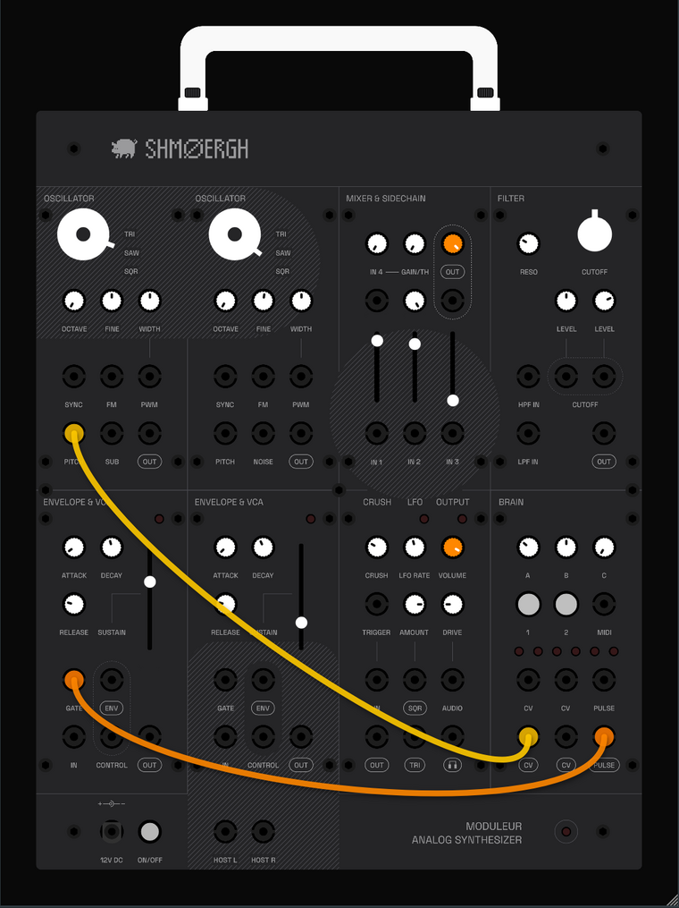

# Shmøergh Moduleur plugin

The official software version of the [Shmøergh Moduleur](https://github.com/shmoergh/moduleur), the open-source analog modular synthesizer. Play it as an Audio Unit or VST3 instrument in your DAW, or on its own as a standalone app.



The plugin has the same eight modules and the same front panel as the hardware. Every module is modelled from its published schematic, so it responds the way the circuits do: a 1 V/oct saw-core oscillator, a three-pole diode ladder filter that can scream into self-oscillation, RC envelopes, a JFET sample-and-hold "bitcrusher" and an LED-clipping output stage. It comes pre-patched like a Moduleur fitted with its default patch board. Play a note and it makes sound. Add patch cables to take it further.

## Modules

| Module | What it does |
| --- | --- |
| **Oscillator** (×2) | Triangle, saw and square from a saw core, with octave and fine tuning, pulse width, hard sync and linear FM. Oscillator 1 also has a sub-octave out, oscillator 2 a noise out. |
| **Mixer & Sidechain** | Three DC-coupled inputs on sliders plus a fourth input with its own gain. Anything patched into IN 4 can duck the mix like a sidechain compressor. |
| **Filter** | A three-pole diode ladder with separate low-pass and high-pass inputs, resonance up to self-oscillation and two cutoff CV inputs with attenuverters. |
| **Envelope & VCA** (×2) | An ADSR with times from about a millisecond to ten seconds, and a VCA. Each envelope already controls its own VCA. |
| **Crush / LFO / Output** | A sample-and-hold bitcrusher (or sample and hold, with an external trigger), a triangle/square LFO from 0.1 to 200 Hz, and the output with LED drive. |
| **Brain** | Runs Le Controlleur, the Brain's firmware: MIDI to CV, or a generative step sequencer. |

## Installing (macOS)

1. Download the zip files from the [latest release](../../releases/latest). They run natively on Apple Silicon and Intel Macs with macOS 10.13 or later.
2. Unzip them and copy the files:
   - `Moduleur.component` (Audio Unit: Logic Pro, GarageBand, MainStage) → `~/Library/Audio/Plug-Ins/Components/`
   - `Moduleur.vst3` (Ableton Live, Bitwig, Reaper, Cubase…) → `~/Library/Audio/Plug-Ins/VST3/`
   - `Moduleur.app` (standalone) → `/Applications`
3. Current releases aren't notarized by Apple yet, so macOS blocks them the first time. Open Terminal and run:

   ```sh
   xattr -dr com.apple.quarantine ~/Library/Audio/Plug-Ins/Components/Moduleur.component \
       ~/Library/Audio/Plug-Ins/VST3/Moduleur.vst3 /Applications/Moduleur.app
   ```

4. Restart your DAW. If Logic Pro doesn't list Moduleur, run `auval -v aumu Mdlr Shmo` in Terminal once.

## Playing

Load **Moduleur** as an instrument and play. In the standalone app, choose your audio output and MIDI keyboard under **Options → Audio/MIDI Settings**.

Out of the box the default patch board is fitted:

- Both oscillators, the sub and the noise feed the mixer.
- The mixer feeds the filter, the filter feeds the first VCA, and the VCA feeds the output.
- The LFO triangle goes to the filter's first CUTOFF input, and envelope 2 to the second. Turn the two LEVEL knobs to hear them.
- The PITCH and GATE jacks of the two voices are linked, so one pitch cable and one gate cable play everything.

A fresh instance also comes with two cables: Brain CV out to oscillator 1 PITCH, and Brain PULSE to envelope 1 GATE.

**Patching.** Drag from one jack to another to add a cable. Drag a cable's end out of a jack to move it, or drop it on the panel to unplug it. Right-click a jack to remove its cables. Plugging into a jack breaks its default connection, just like on the hardware.

**Knobs and sliders.** Drag up and down. Double-click to reset. Every control can be automated from your DAW.

**The menu.** Right-click the panel to resize the window, change cable opacity, switch the Brain's firmware, remove the default patch board, reset to the starting patch, or send a panic.

## The Brain

MIDI from your DAW goes to the Brain, which runs Le Controlleur in one of two modes.

**MIDI to CV** (the default). The first CV out carries pitch, the second carries velocity, and PULSE carries the gate.

- Hold **1** and turn **A** to pick a MIDI channel. Until you pick one, it listens on all channels.
- Hold **2** and turn **B** to choose which CV out carries pitch.
- Hold **2** and turn **C** to make the second CV out carry velocity, mod wheel, the same pitch (unison) or a second note (duophonic).
- Tap **1** and **2** together to silence stuck notes.

**Sequencer.** Hold **1** and **2** together for 1.5 seconds to switch modes.

- **1** starts and stops it.
- **A** sets the tempo. Turned fully left, it follows the PULSE input, or your DAW's transport if nothing is patched there.
- **B** sets the note range. **C** adds randomness: fully left, the sequence stays locked; turned up, notes and rhythms keep changing.
- Hold **2** for the second layer: swing on A, scale on B, sequence length on C.
- Double-tap and hold **2** to transpose with B (octave) and C (key).

## Plugin extras

- **HOST L / HOST R** carry your DAW's sidechain input, or the audio input in the standalone app. Patch a drum loop into the mixer's IN 4 to make the mix pump, or run any audio through the filter.
- **ON/OFF** mutes the output.

## Building from source

You need Xcode (or the Command Line Tools) and CMake 3.22 or later. JUCE is downloaded automatically.

```sh
cmake -S . -B build -G Xcode
cmake --build build --config Release
ctest --test-dir build -C Release
```

On macOS the Audio Unit and VST3 are copied into `~/Library/Audio/Plug-Ins` after building. To turn that off, add `-DMODULEUR_COPY_AFTER_BUILD=OFF`. The VST3 and the standalone app also build on Linux.

How each module is modelled is described in [docs/DSP.md](docs/DSP.md). Maintainers will find the release process in [docs/RELEASING.md](docs/RELEASING.md).

## Licence

The panel design and artwork are licensed under [CC BY-NC 4.0](https://creativecommons.org/licenses/by-nc/4.0/), like the Moduleur hardware.

The software is licensed under [MIT](https://opensource.org/license/mit). See [LICENSE](LICENSE) for details and third-party notices.
